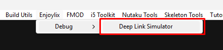
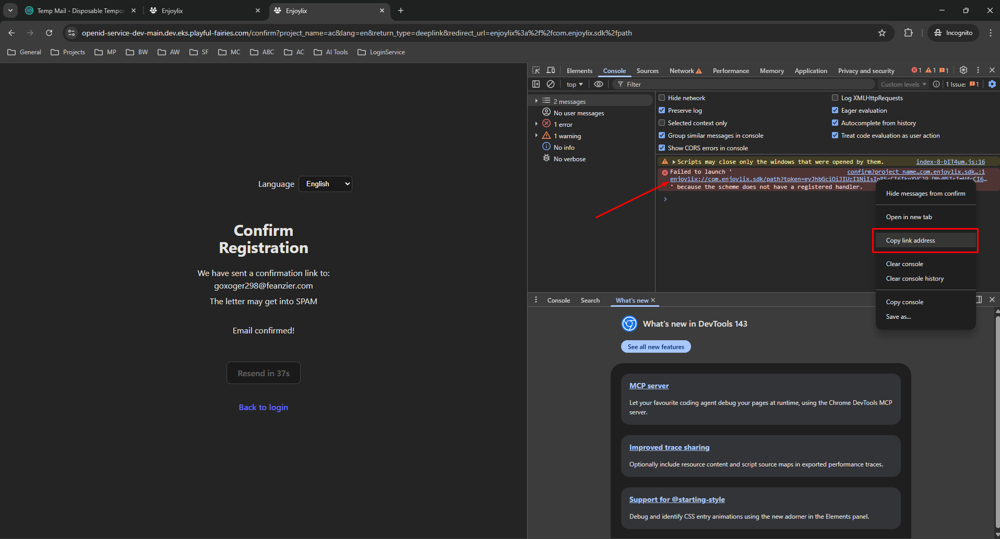
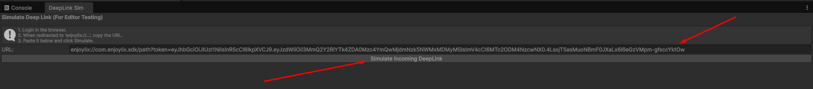

# Enjoylix Unity SDK

---

> 💡Tip: You can refer to our [GitBook](https://enjoylix.gitbook.io/docs) to get context of front-end and backend-end functions with Client side (Unity SDK)

---

Unity SDK for integrating Enjoylix OpenID authentication, Payments, Age Verification and Attribution into partner projects.

The SDK provides:

- Guest login
- OpenID login via browser
- Guest → OpenID account linking
- Unified login on startup — one call that restores a session or hands off to the browser
- Payments via browser
- Age verification via browser
- Attribution events — automatic session `ping`; helper methods for `login`, `registration`, `purchase`, `tutorial`

> Upgrading from 1.x? See [Migrating from 1.x](#migrating-from-1x) — `InitializeAsync()`, `EnsureEmailLoginAsync()`, the single-argument constructor and the `.Auth` property were removed in 2.0.0.

---

## Supported Platforms

| Platform | Status |
| :---- | :---- |
| Android / iOS | ✅ |
| WebGL | ✅ |
| Unity Editor | ✅ |

### Platform Behavior

- **Mobile** — browser return via deeplink
- **WebGL** — browser return via `post_message`
- **Editor** — browser return via deeplink where you should use [Deep Link Simulator](#deep-link-simulation-editor-only)

---

## Installation

### Unity Package Manager (UPM)

Add the SDK to your `manifest.json` as a git dependency:

```json
{
  "dependencies": {
    "com.enjoylix.sdk": "https://github.com/enjoylix/unity-enjoylix-sdk.git#<tag>"
  }
}
```

Replace `<tag>` with any existing release tag from the repository's tags (e.g. `2.0.16`).

Alternatively, in Unity: `Window → Package Manager → + → Add package from git URL…` and paste
`https://github.com/enjoylix/unity-enjoylix-sdk.git#<tag>`.

> Unity needs a `git` executable available in `PATH`. The repository is public, no credentials are required.

---

## Configuration

### 1\. Create EnjoylixConfig

In Unity:

```
Assets → Create → Enjoylix → EnjoylixConfig
```

Fill in:

- `ProjectName` — your agreed project name (e.g. `test_game`)
- `DeepLinkScheme` — mobile only, the scheme the browser returns to (e.g. `enjoylix://com.your_company.your_app/path`)
- `Partner` — partner identifier agreed with Enjoylix, sent with every attribution event
- `CurrentEnvironment` — `Dev` or `Prod`
- `DevEnvironment` / `ProdEnvironment` — references to `EnjoylixEnvironment` assets (see below)
- `StorageEncryptionSalt` — unique random string used to encrypt the stored refresh token. Set it once before you ship: changing it later logs every existing player out.
- `WebPortalMode` — WebGL only. `Auto` (default), `Portal` or `Standalone`. Set `Standalone` if you embed the build in an iframe on your own site.

### 2\. Create EnjoylixEnvironment

In Unity:

```
Assets → Create → Enjoylix → EnjoylixEnvironment
```

Create one per environment and reference them from the config:

- `BaseServiceUrl` — URL for Auth & Payment services.
- `AttributionServiceUrl` — URL for Attribution events.
- `RequestSignSecret` — key that signs the purchase request, one per environment. Replace the `YOUR_SIGN_KEY_PROVIDED_BY_ENJOYLIX_TEAM` placeholder with the key issued by the Enjoylix team.

---

## SDK Initialization

The SDK must be initialized **once at application startup**.

```c#
using EnjoylixSDK;
using EnjoylixSDK.Config;
using UnityEngine;

public class EnjoylixBootstrap : MonoBehaviour
{
    [SerializeField] private EnjoylixConfig config;
    public static EnjoylixSdk Sdk;

    private void Awake()
    {
        Sdk = new EnjoylixSdk(config, "ENJOYLIX_ANDROID"); // the platform string agreed with Enjoylix
        Sdk.Initialize();
    }
}
```

`Initialize()` is **synchronous** and makes no network calls — it only loads a persisted session from local storage. It does not log the player in; call one of the login methods afterwards.

The second constructor argument, `platform`, is required. It is an arbitrary string agreed with the Enjoylix team (it does not have to be `Application.platform.ToString()`): the backend uses it to decide per-platform behaviour such as age verification, and it is the `platform` reported on every attribution event.

```c#
// Same WebGL build, two deployments:
Sdk = new EnjoylixSdk(config, "web_enjoylix");   // on the Enjoylix portal
Sdk = new EnjoylixSdk(config, "web_own_site");   // on your own site
```

---

## Authentication

### Login on Startup (recommended)

One call that restores a stored session if one is still usable, and otherwise hands off to the browser. Inside the Enjoylix web portal it routes to the portal handshake automatically.

```c#
string deviceId = SystemInfo.deviceUniqueIdentifier;
var session = await EnjoylixBootstrap.Sdk.LoginOnStartAsync(deviceId);
```

---

### Guest Login

```c#
string deviceId = SystemInfo.deviceUniqueIdentifier;
string guestId = await EnjoylixBootstrap.Sdk.LoginGuestAsync(deviceId);
```

---

### OpenID Login (Browser)

```c#
var session = await EnjoylixBootstrap.Sdk.LoginOpenIdAsync();
```

---

### Link Guest → OpenID

```c#
string deviceId = SystemInfo.deviceUniqueIdentifier;
var session = await EnjoylixBootstrap.Sdk.LinkGuestAsync(deviceId);
```

---

### Login with Existing Token

```c#
var session = await EnjoylixBootstrap.Sdk.PerformLoginWithTokenAsync(accessToken);
```

---

### Logout

```c#
EnjoylixBootstrap.Sdk.Logout();
```

---

### Session State

| Member | Type | Meaning |
| :---- | :---- | :---- |
| `AccessToken` | `string` | Current access token, or `null`. |
| `EnjoylixId` | `string` | The player's Enjoylix account id, or `null` while no session exists. |
| `IsEmailLogin` | `bool` | The current session is a full (non-guest) account. |
| `IsKnownFullAccount` | `bool` | This device is known to belong to a full account — available on startup before login. |
| `IsWebPortal` | `bool` | The WebGL build runs inside the Enjoylix portal. |

Before any request of your own that carries the token, call `EnsureValidTokenAsync()`. When a full (OpenID) session can no longer be renewed it throws `InvalidOperationException` — show your own login screen.

```c#
var session = await EnjoylixBootstrap.Sdk.EnsureValidTokenAsync();
```

---

## Payments

The SDK handles the purchase flow via browser (similar to login). Purchases are available to all users, including guests.

```c#
using EnjoylixSDK.Purchase.Models;

var request = new PurchaseCreateRequest
{
    coin_amount = 100,
    game_name = "my_game_project", // Agreed project name
    transaction_id = Guid.NewGuid().ToString("N"), // Your internal unique ID
    transaction_name = "Gold Pack Small",
    transaction_image_url = "https://mysite.com/gold.png"
};

// Opens browser, waits for payment, returns result
PaymentResult result = await EnjoylixBootstrap.Sdk.PurchaseCreateAsync(
    request, 
    TimeSpan.FromMinutes(5)
);

if (result == null)
{
    // The browser blocked the payment window — OnPopupBlocked has fired
    return;
}

if (result.success)
{
    Debug.Log($"Purchase Successful! Payment ID: {result.payment_id}");
}
else
{
    Debug.LogError($"Purchase Failed: {result.error}");
}
```

If the player returns to the game without completing the payment, the call throws `UserDismissedException`. On WebGL, if the player declines your `window.EnjoylixConfirmOpen` confirmation, it throws `UserCancelledException` — see "Popup Blocking" in the [SDK guide](Documentation~/enjoylix_sdk_docs.md#popup-blocking).

---

## Age Verification

```c#
if (await EnjoylixBootstrap.Sdk.IsAgeVerificationNeededAsync())
{
    bool verified = await EnjoylixBootstrap.Sdk.StartAgeVerificationAsync(TimeSpan.FromMinutes(5));
}
```

Both methods require an active session. Whether verification is needed is decided by the backend from the `platform` string passed to the constructor.

---

## Attribution

The SDK automatically sends only one event:

- `ping` — session heartbeat: sent once an Enjoylix session exists and the game has called `SetPlayerId()`, then every 6 hours while the game is running (stops on `Logout()`)

`login`, `registration`, `tutorial:complete` and purchase events are **not** sent automatically — use the manual tracking methods below for the client-side fallback.

On WebGL the query params the game was launched with (`?utm_source=facebook&utm_campaign=summer_sale`) are captured from the game url and sent both with attribution events and on the token request, so an in-game registration stays attributed to the campaign the player came from. No integration code required.

### Player Id

Hand over your in-game profile id as soon as the game resolves it — the session `ping` is not sent until you do:

```c#
EnjoylixBootstrap.Sdk.SetPlayerId(profile.Id);
```

### Manual Tracking

```c#
EnjoylixBootstrap.Sdk.TrackLogin();
EnjoylixBootstrap.Sdk.TrackRegistration();
EnjoylixBootstrap.Sdk.TrackTutorialComplete();
```

```c#
EnjoylixBootstrap.Sdk.TrackPurchase(
    "purchase:complete",
    "google_play",
    "checkout_1",
    "tx_123",
    4.99f,
    "USD",
    false
);
```

---

## Android Deeplink Setup

For mobile builds, add an intent-filter to `AndroidManifest.xml`.

Example:

```xml
<intent-filter>
    <action android:name="android.intent.action.VIEW"/>
    <category android:name="android.intent.category.DEFAULT"/>
    <category android:name="android.intent.category.BROWSABLE"/>

    <data
        android:scheme="enjoylix"
        android:host="com.enjoylix.sdk"
        android:pathPrefix="/path"/>
</intent-filter>
```

---

## iOS Deeplink Setup

For iOS builds, you must register the URL Scheme in Unity Player Settings:

1. Go to **Edit → Project Settings → Player → iOS tab**.
2. Expand **Other Settings**.
3. Scroll down to **Configuration → Supported URL schemes**.
4. Increase **Size** and add your scheme name (e.g., `enjoylix`).

*Note: Do not include `://` or the package name here, just the scheme word.*

---

## Deep Link Simulation (Editor Only)

Since the Unity Editor cannot natively intercept custom URL schemes (like `enjoylix://`), the SDK provides a helper tool to simulate the login callback manually.

**How to use:**

1.  In the Unity menu bar, go to **Enjoylix > Debug > Deep Link Simulator**.
    
2.  Dock the opened window somewhere convenient.
3.  Enter **Play Mode** and start a login (e.g. `LoginOpenIdAsync`).
4.  Your default browser will open the auth page. Complete the login process. Confirm email.
5.  **Crucial Step**: When the browser redirects you to the final URL (e.g., `enjoylix://com.enjoylix.sdk/path?token=...`), copy this entire URL from the browser.
    *   *Note: The browser will likely show a "Page not found" or "Open application" error. This is normal. Just copy the url from DevTools Console.*
        
6.  Paste the URL into the **Deep Link Simulator** window.
7.  Click **Simulate Incoming DeepLink**.
    

The SDK will intercept this string as if it came from the OS, completing the login flow.

---

## Important Notes

- **WebGL** is the only platform using \`post\_message\`.
- **Android / iOS** requires a configured `DeepLinkScheme` to return from the browser to the game.
- **Unity Editor** is intended only for local testing via [Deep Link Simulator](#deep-link-simulation-editor-only).

---

## Migrating from 1.x

| 1.x | 2.x |
| :---- | :---- |
| `new EnjoylixSdk(config)` | `new EnjoylixSdk(config, platform)` — `platform` is required |
| `await Sdk.InitializeAsync()` | `Sdk.Initialize()` (synchronous, no login), then `await Sdk.LoginOnStartAsync(deviceId)` |
| `await Sdk.EnsureEmailLoginAsync()` | Removed — purchases are available to guests as well. To ask a guest for a full account, check `Sdk.IsEmailLogin` and call `Sdk.LinkGuestAsync(deviceId)` |
| `Sdk.Auth.LoginGuestAsync(deviceId)` | `Sdk.LoginGuestAsync(deviceId)` |
| `Sdk.Auth.LoginOpenIdAsync()` | `Sdk.LoginOpenIdAsync()` |
| `Sdk.Auth.LinkGuestAsync(deviceId)` | `Sdk.LinkGuestAsync(deviceId)` |
| `Sdk.Auth.PerformLoginWithTokenAsync(token)` | `Sdk.PerformLoginWithTokenAsync(token)` |
| `Sdk.Auth.Logout()` | `Sdk.Logout()` |

Version-by-version changes are listed in the [Migration Changelog](https://enjoylix.gitbook.io/docs/client-documentation/migration-changelog).

---

## Documentation

- [SDK Guide](Documentation~/enjoylix_sdk_docs.md) — integration guide with error handling, popup blocking and portal details
- [API Reference](Documentation~/API.md) — every public method, property, event and model
